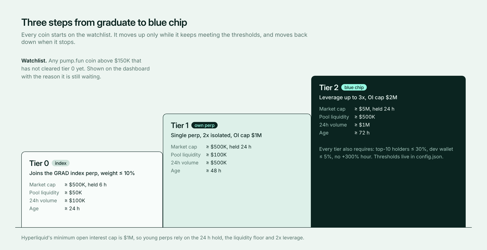
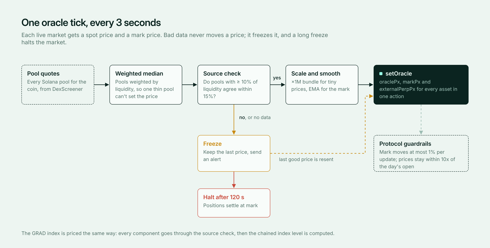

# Listing and delisting policy

Every number here is a starting value from `config.json`. Calibrate it on testnet and against history.

## Criteria

| Metric | Tier 0 | Tier 1 | Tier 2 |
|---|---|---|---|
| Market cap, held (not a spike) | ≥ $500K for 6 h | ≥ $500K for 24 h | ≥ $5M for 24 h |
| Pool liquidity | ≥ $50K | ≥ $100K | ≥ $500K |
| Token age | ≥ 24 h | ≥ 48 h | ≥ 72 h |
| 24h spot volume | ≥ $100K | ≥ $500K | ≥ $1M |
| Max leverage | index only | 2x | 3x |
| OI cap | index cap | $1M (protocol minimum) | $2M |

**Safety filters (every tier):**

- The coin launched on pump.fun (mint ends in `pump`). This can be switched off in config.
- The top 10 holders, excluding the pool, own ≤ 30%. The dev wallet owns ≤ 5%.
- No move above +300% in the last hour, so nothing is listed mid-pump.

Tier 0 and up is automatic. A tier 1 listing takes a slot and adds slashing risk, so by default a person confirms it with `python -m hip3 list <mint>`. Set `manager.auto_list_tier1` to list automatically.

## Why single perps need more than $500K alone

The protocol will not accept an OI cap below $1M. A coin at $500K often has a pool of $50K to $100K, so open interest can exceed spot liquidity many times over, and one wallet can push the pool against perp positions. A single perp therefore also needs the cap held for 24 hours, at least $100K in the pool, $500K of daily volume and two days of history, and it trades at 2x at most. If the pool thins out, the market is halted (see delisting below). Raise these numbers in `config.json` if you see manipulation on testnet.

## GRAD index

- Up to 50 coins from tier 0 and above, chosen by liquidity.
- Weights proportional to √liquidity, capped at 10% per coin.
- Rebalanced every 24 h. The level is chained, so it never jumps when the composition changes.
- Starts at 1000.

## Delisting

A single perp is halted with `haltTrading` (positions settle at mark) when:

- market cap stays below 50% of its tier threshold for 24 h;
- pool liquidity falls below 50% of the tier threshold;
- the oracle stays frozen longer than 120 s.

An index component is removed at the next rebalance. If its pool liquidity collapses (a rug), it is removed immediately and its weight moves to the rest.

## Oracle stops

- **Sources disagree by more than 15%, or data is missing.** The price is frozen, the last good price is resent, and an alert goes out.
- **Frozen for 120 s.** The market is halted.
- **Price moves more than 40% in a minute.** An alert goes out; prices keep updating.

**Known limit:** in a −90% rug the protocol can move the mark only about 1% every 3 seconds. Positions live on a stale price for a while, and losses fall to the backstop liquidator and ADL. Low leverage, isolated margin and the index-first design exist because of this.
