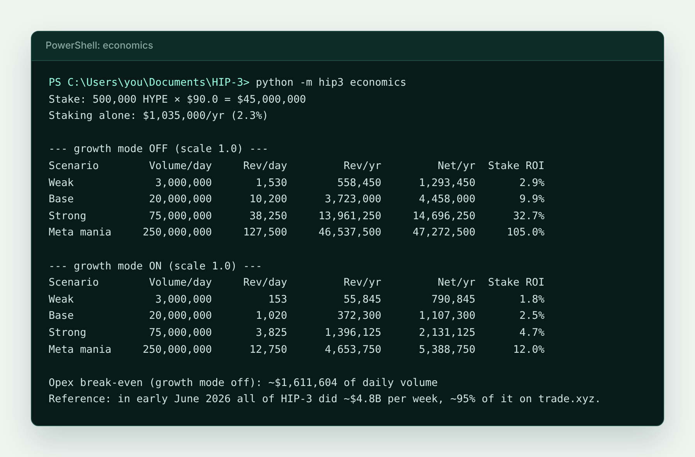

# Economics

Calculator: `python -m hip3 economics` (`economics/model.py`; every assumption is at the top of the file).

## How the deployer earns

- At `scale = 1.0` without growth mode, traders pay double the base rate: taker 0.09%, maker 0.03%. The deployer keeps half, roughly 0.045% plus 0.015% per trade.
- After trader discounts (referrals, staking), the deployer keeps about **0.051% of volume**.
- Growth mode cuts everything by about 10x. It buys volume but almost no revenue, so HyperGrad ships with it off.
- On top of that, the stake earns ordinary HYPE staking yield (~2.3%).

## Scenarios (HYPE at $90, $45M stake, $25K/month opex)

| Scenario | Daily volume | Deployer revenue per year | Net return on stake |
|---|---|---|---|
| Weak | $3M | $0.56M | 2.9% |
| Base | $20M | $3.7M | 9.9% |
| Strong | $75M | $14.0M | 32.7% |
| Meta mania | $250M | $46.5M | 105.0% |

Opex break-even is about **$1.6M of daily volume**.

## Reality check

- All of HIP-3 did about $4.8B per week in early June 2026, and ~95% of it was trade.xyz. Other deployers shared the rest. Felix closed its HIP-3 DEX in June 2026.
- HyperGrad's edge is that no one serves this niche. The risk is that memecoin traders stay on Hyperliquid's native markets, which already list the biggest memes.
- The largest cost is not opex but **capital**: $45M of HYPE carries HYPE price risk and slashing risk. With Kinetiq Launch, stakers take that on in exchange for a share of fees. Borsa, for example, gives its stakers 12.5% of revenue.
